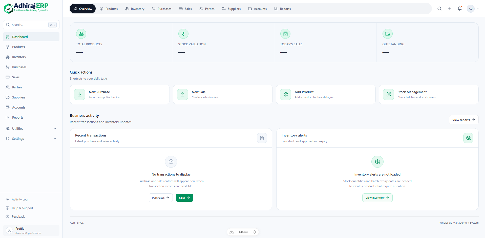
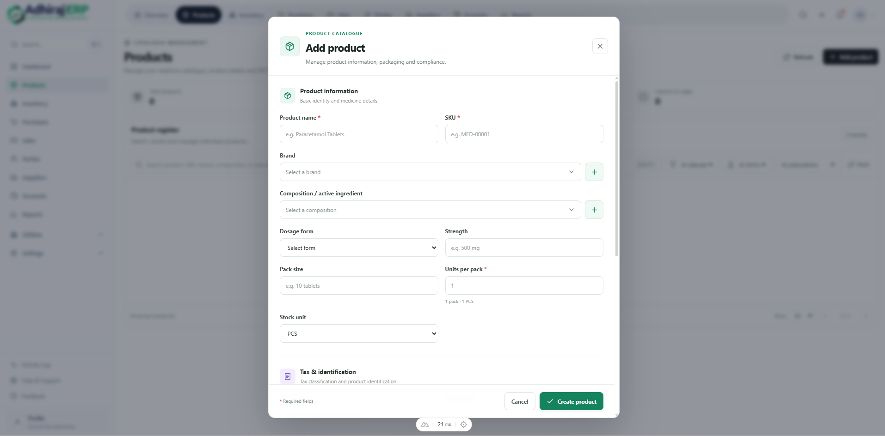
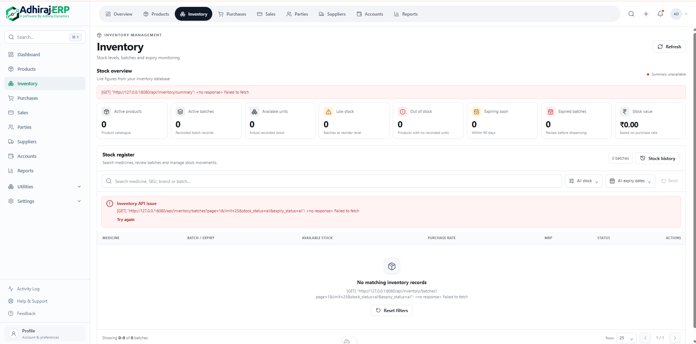
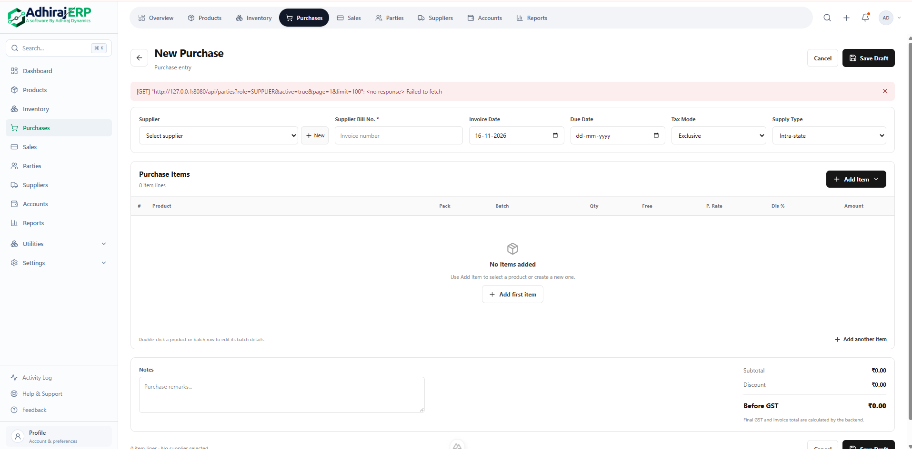
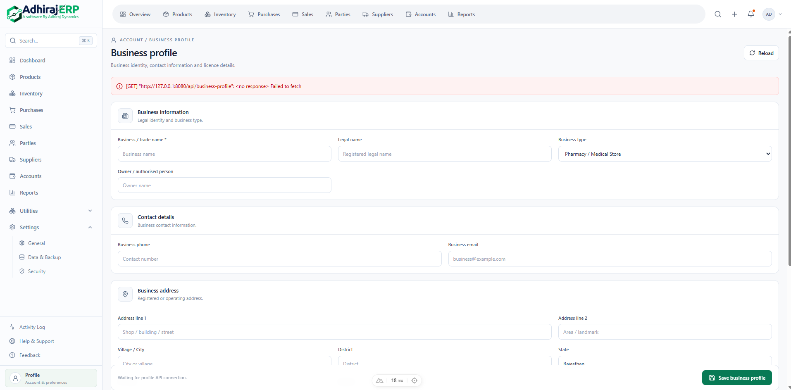

 
<div align="center">


# AdhirajPOS
### Pharmacy & Wholesale Business Management System

**A software by Adhiraj Dynamics**

[](https://nuxt.com/)
[](https://vuejs.org/)
[](https://www.rust-lang.org/)
[](https://www.postgresql.org/)
[](https://www.typescriptlang.org/)
[](LICENSE)

**Inventory · Purchases · Sales · Parties · Accounts · Reports**

</div>

---

## Overview

**AdhirajPOS** is a pharmacy and wholesale business management system designed to streamline medicine cataloguing, inventory tracking, purchase management, and day-to-day business operations.

Built with a modern Nuxt frontend and a Rust-powered backend, the project aims to provide a responsive, reliable, and efficient management experience for medical stores, distributors, and wholesale pharmacies.

The system is designed around medicine-specific workflows, including product brands, compositions, HSN classification, batch-wise stock records, expiry monitoring, and purchase entry.

## Key Features

### Product Management
- Product catalogue with SKU and medicine details.
- Brand and composition management.
- Dosage form, strength, pack size, and stock unit.
- HSN classification and GST-related information.
- Product creation and editing interface.

### Inventory Management
- Batch-wise inventory records.
- Batch and expiry date tracking.
- Stock overview and inventory summaries.
- Low-stock and expiry monitoring.
- Stock adjustments and movement history.
- FEFO-oriented inventory design.

### Purchase Management
- Supplier-based purchase entry.
- Supplier invoice number and invoice dates.
- Due date and tax mode selection.
- Intra-state and inter-state supply types.
- Purchase item entry with batch, quantity, free quantity, purchase rate, and discount.
- Purchase totals and backend-side invoice calculations.
- Draft and purchase posting workflows.

### Parties Management
- Supplier and customer records.
- Party roles and status management.
- Search, pagination, and party details.

### Business Profile
- Business identity and legal details.
- Owner and authorised person information.
- Contact information and business address.
- Pharmacy-related licence details.

### Master Data & Utilities
- Brand master.
- Composition master.
- HSN master.
- CSV-based import and staging utilities for product and master data.

## Technology Stack

| Layer | Technology |
|---|---|
| Frontend framework | Nuxt 4 |
| UI framework | Vue 3 |
| Language | TypeScript |
| UI components | Nuxt UI |
| Styling | Tailwind CSS 4 |
| Icons | Lucide Vue Next |
| Backend | Rust |
| API framework | Axum |
| Database access | SQLx |
| Database | PostgreSQL |
| Desktop integration | Tauri 2 dependencies |

## Project Architecture

```text
AdhirajPOS/
│
├── app/
│   ├── assets/
│   │   └── css/
│   ├── components/
│   │   ├── dashboard/
│   │   ├── layout/
│   │   ├── parties/
│   │   └── products/
│   ├── composables/
│   ├── layouts/
│   └── pages/
│
├── backend/
│   ├── migrations/
│   ├── scripts/
│   ├── src/
│   │   ├── config.rs
│   │   ├── db/
│   │   ├── routes/
│   │   └── main.rs
│   ├── Cargo.toml
│   └── Cargo.lock
│
├── Documents/
│   └── Import datasets and staging files
│
├── public/
├── docs/
│   └── adhirajpos-cover.png
│
├── nuxt.config.ts
├── package.json
├── pnpm-lock.yaml
└── README.md
```

## Getting Started

### Prerequisites

Install the following tools:

- [Node.js](https://nodejs.org/)
- [pnpm](https://pnpm.io/)
- [Rust](https://www.rust-lang.org/tools/install)
- [PostgreSQL](https://www.postgresql.org/)

### 1. Clone the repository

```bash
git clone https://github.com/miltonbiswas/adhirajerptest.git
cd adhirajerptest
```

### 2. Install frontend dependencies

```bash
pnpm install
```

### 3. Start the frontend

```bash
pnpm dev
```

Open:

```text
http://localhost:3000
```

### 4. Configure the backend

Create a `.env` file inside the `backend/` directory.

Configure the following environment variables using your own PostgreSQL credentials:

```env
DB_HOST=127.0.0.1
DB_PORT=5432
DB_NAME=adhirajpos
DB_USER=postgres
DB_PASSWORD=your_database_password

SERVER_HOST=127.0.0.1
SERVER_PORT=8080
```

**Important:** Never commit your `.env` file or expose database credentials.

### 5. Run the backend

```bash
cd backend
cargo run
```

The backend uses Axum and connects to PostgreSQL through SQLx. Pending database migrations are configured to run automatically when the backend starts.

Default backend address:

```text
http://127.0.0.1:8080
```

## API Overview

The Rust backend provides REST API routes for the following modules:

| Module | API Endpoint |
|---|---|
| Health | `/api/health` |
| Products | `/api/products` |
| Brands | `/api/brands` |
| Compositions | `/api/compositions` |
| Parties | `/api/parties` |
| Inventory | `/api/inventory` |
| Purchases | `/api/purchases` |
| HSN | `/api/hsn` |
| Business Profile | `/api/business-profile` |

## Database & Migrations

AdhirajPOS uses PostgreSQL as its primary relational database.

The backend includes SQL migration files covering the application's database structure, including:

- Products and product classification.
- Brands and compositions.
- Product batches and stock movements.
- Suppliers, customers, and parties.
- Purchase invoices and purchase items.
- Supplier ledger entries.
- HSN and tax-related information.
- Business profile.
- Product import staging.

Database migrations are managed through SQLx.

## Screenshots

<div align="center">

### Dashboard


### Product Management


### Inventory Management


### Purchase Management


### Business Profile


</div>

## Development Status

AdhirajPOS is an actively developed project. The repository contains the frontend application, Rust backend modules, database migrations, and supporting import datasets.

Some areas remain under development and require further integration and testing.

### Planned Improvements

- [ ] Complete sales and invoicing workflows.
- [ ] Customer and supplier ledger management.
- [ ] Accounts and financial reporting.
- [ ] Advanced reports and analytics.
- [ ] Purchase and sales return handling.
- [ ] Complete desktop packaging and Tauri integration.
- [ ] Comprehensive testing and production hardening.

## License

This project is licensed under the **MIT License**. See the [LICENSE](LICENSE) file for details.

## Author

**Milton Biswas**

Pharmacist · Developer · Founder

**Adhiraj Dynamics**

- GitHub: [@miltonbiswas](https://github.com/miltonbiswas)
- Project Repository: [AdhirajPOS](https://github.com/miltonbiswas/adhirajerptest)

---

<div align="center">

**Built with dedication by Adhiraj Dynamics.**

*Modern technology for smarter pharmacy management.*

</div>
